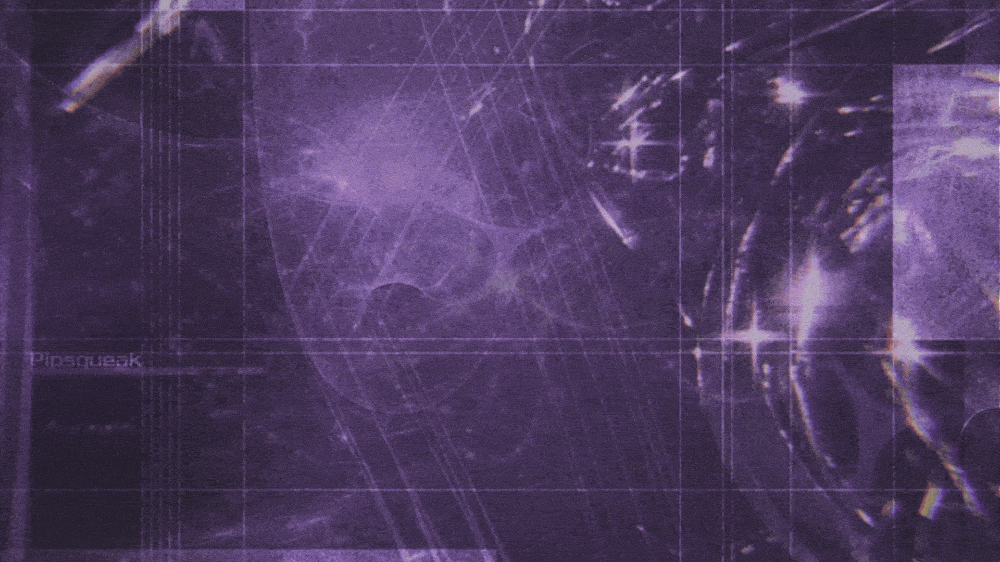

  

## Sobre mí

Mi nombre es María Alay y soy estudiante de 5to semestre de Ingeniería en Computación en la Escuela Superior Politécnica del Litoral (ESPOL). Durante mi carrera universitaria he descubierto lo interesante y diverso que puede ser el mundo de la computación, ya que he disfrutado aprender sobre distintas áreas. Todavía no me he decidido por una en particular, pues cada una tiene algo que despierta mi curiosidad y me motiva a seguir aprendiendo.

Me gusta investigar, recopilar información y experimentar con lo que voy aprendiendo, por esto continúo explorando 
nuevas herramientas y conocimientos que me permitan crecer en este campo.

## Áreas de Interés
Me interesa explorar áreas relacionadas con el desarrollo de software y los sistemas. Tengo curiosidad por las distribuciones Linux y me gustaría experimentar con otras, además de profundizar en la arquitectura de computadores y el lenguaje ensamblador MIPS.

  
  
  

También me gustaría seguir aprendiendo sobre desarrollo web y de aplicaciones, especialmente en el diseño y organización de interfaces. Otro de mis intereses es el desarrollo de videojuegos, donde me gustaría combinar la creatividad del arte con la lógica de la computación, tanto en sus conceptos visuales como en sus mecánicas.

## Habilidades y Tecnologías
### Lenguajes de Programación

### Desarrollo Web

### Control de Versiones y Plataformas de Desarrollo

### IDE

### Herramientas y Pruebas

### Diseño

## Proyectos Destacados
| Proyecto | Descripción | Tecnologías Utilizadas | Demo |
| --- | --- | --- | --- |
| [Proyecto02-ChoqueGeneracional](https://github.com/RomeroAbraham/Proyecto02-ChoqueGeneracional) | Sitio web que explora la evolución de los juegos entre generaciones en Guayaquil, a partir de entrevistas. | `SCSS` `CSS` `HTML` `JavaScript` | [Choque Generacional](https://romeroabraham.github.io/Proyecto02-ChoqueGeneracional/) |
| [Motor_BD_Java](https://github.com/Omarplay11/Motor_BD_Java) | Programa en Java que simula un motor SQL mediante archivos CSV y conceptos de Matemáticas Discretas. | `Java` `Archivos CSV` | No posee demo |
| [POO4_1P_ALAY_ALBARRACIN_ESCOBAR](https://github.com/MariaAlayM/POO4_1P_ALAY_ALBARRACIN_ESCOBAR) | Aplicación de consola en Java que simula un sistema de ventas, aplicando principios de POO. | `Java` `Javadoc` `Archivos TXT` | No posee demo |

## Mi Estadísticas de GitHub

  

  

## Contacto

